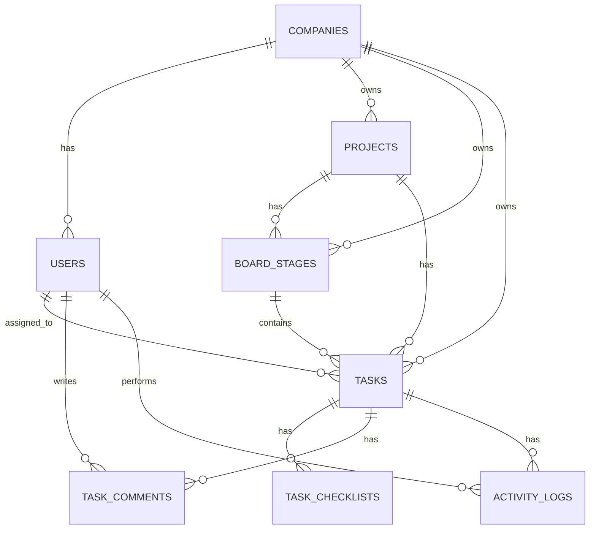

# 🗄️ Veritabanı Tasarım Dokümanı (Database Design)

Bu doküman, **Proje Takip Panosu** uygulamasının ilişkisel veritabanı şemasını, tablolarını, veri tiplerini ve aralarındaki ilişkileri tanımlar. Mentör onayına sunulmak üzere hazırlanmıştır.

---

## 📊 ER (Entity-Relationship) Diyagramı

---

## 🗂️ Tablo Detayları ve Şema Yapısı

### 1. `companies` (Mevcut Tablo)
Şirketlerin (Tenant) bilgilerini tutar.
* `id` (SERIAL, PRIMARY KEY)
* `name` (VARCHAR(255), NOT NULL) - Şirket adı
* `slug` (VARCHAR(100), NOT NULL, UNIQUE) - Şirket takma adı (login için kullanılır)
* `created_at` (TIMESTAMP, NOT NULL, DEFAULT CURRENT_TIMESTAMP)

---

### 2. `users` (Mevcut Tablo)
Kullanıcı bilgilerini tutar.
* `id` (SERIAL, PRIMARY KEY)
* `company_id` (INTEGER, NOT NULL, REFERENCES companies(id) ON DELETE CASCADE)
* `email` (VARCHAR(255), NOT NULL)
* `password_hash` (VARCHAR(255), NOT NULL)
* `role` (VARCHAR(50), NOT NULL, DEFAULT 'admin') - Kullanıcı yetkisi
* `created_at` (TIMESTAMP, NOT NULL, DEFAULT CURRENT_TIMESTAMP)
* *Kısıt (Constraint):* `UNIQUE(company_id, email)` - Aynı şirket içinde email tekrar edemez.

---

### 3. `projects` (Modül 1)
Şirketlerin oluşturduğu projeleri tutar.
* `id` (SERIAL, PRIMARY KEY)
* `company_id` (INTEGER, NOT NULL, REFERENCES companies(id) ON DELETE CASCADE)
* `name` (VARCHAR(255), NOT NULL) - Proje adı
* `description` (TEXT) - Proje açıklaması
* `is_archived` (BOOLEAN, NOT NULL, DEFAULT FALSE) - Arşivlenme durumu
* `created_at` (TIMESTAMP, NOT NULL, DEFAULT CURRENT_TIMESTAMP)

---

### 4. `board_stages` (Modül 1)
Projelere ait pano aşamalarını (sütunları) tanımlar.
* `id` (SERIAL, PRIMARY KEY)
* `company_id` (INTEGER, NOT NULL, REFERENCES companies(id) ON DELETE CASCADE)
* `project_id` (INTEGER, NOT NULL, REFERENCES projects(id) ON DELETE CASCADE)
* `name` (VARCHAR(100), NOT NULL) - Sütun adı (örn: "Yapılacaklar", "Devam Ediyor")
* `order_no` (INTEGER, NOT NULL) - Sütunun panodaki sırası
* `created_at` (TIMESTAMP, NOT NULL, DEFAULT CURRENT_TIMESTAMP)
* *Kısıt (Constraint):* `UNIQUE(project_id, order_no)` - Bir projede aynı sırada birden fazla sütun olamaz.

---

### 5. `tasks` (Modül 2)
Projelerdeki görevleri tutar.
* `id` (SERIAL, PRIMARY KEY)
* `company_id` (INTEGER, NOT NULL, REFERENCES companies(id) ON DELETE CASCADE)
* `project_id` (INTEGER, NOT NULL, REFERENCES projects(id) ON DELETE CASCADE)
* `stage_id` (INTEGER, NOT NULL, REFERENCES board_stages(id) ON DELETE CASCADE) - Görevin bulunduğu sütun
* `title` (VARCHAR(255), NOT NULL) - Görev başlığı
* `description` (TEXT) - Görev açıklaması
* `priority` (VARCHAR(50), NOT NULL, DEFAULT 'medium') - Öncelik (low, medium, high)
* `due_date` (TIMESTAMP) - Görevin son teslim tarihi
* `assigned_user_id` (INTEGER, REFERENCES users(id) ON DELETE SET NULL) - Görevin atandığı sorumlu
* `created_at` (TIMESTAMP, NOT NULL, DEFAULT CURRENT_TIMESTAMP)

---

### 6. `task_checklists` (Modül 2)
Görevlerin altındaki yapılacaklar (checklist) listesini tutur.
* `id` (SERIAL, PRIMARY KEY)
* `company_id` (INTEGER, NOT NULL, REFERENCES companies(id) ON DELETE CASCADE) - Tenant izolasyonu için
* `task_id` (INTEGER, NOT NULL, REFERENCES tasks(id) ON DELETE CASCADE) - Bağlı olduğu görev
* `title` (VARCHAR(255), NOT NULL) - Yapılacak işin tanımı
* `is_completed` (BOOLEAN, NOT NULL, DEFAULT FALSE) - Tamamlandı mı?
* `created_at` (TIMESTAMP, NOT NULL, DEFAULT CURRENT_TIMESTAMP)

---

### 7. `task_comments` (Modül 3)
Görevlere yapılan kullanıcı yorumlarını tutar.
* `id` (SERIAL, PRIMARY KEY)
* `company_id` (INTEGER, NOT NULL, REFERENCES companies(id) ON DELETE CASCADE)
* `task_id` (INTEGER, NOT NULL, REFERENCES tasks(id) ON DELETE CASCADE)
* `user_id` (INTEGER, NOT NULL, REFERENCES users(id) ON DELETE CASCADE) - Yorumu yapan kişi
* `content` (TEXT, NOT NULL) - Yorum içeriği
* `created_at` (TIMESTAMP, NOT NULL, DEFAULT CURRENT_TIMESTAMP)

---

### 8. `activity_logs` (Modül 3)
Görevler üzerinde yapılan tüm hareketleri tutar (Audit Log).
* `id` (SERIAL, PRIMARY KEY)
* `company_id` (INTEGER, NOT NULL, REFERENCES companies(id) ON DELETE CASCADE)
* `task_id` (INTEGER, NOT NULL, REFERENCES tasks(id) ON DELETE CASCADE)
* `user_id` (INTEGER, NOT NULL, REFERENCES users(id) ON DELETE CASCADE) - İşlemi yapan kişi
* `action_type` (VARCHAR(100), NOT NULL) - Eylemin türü (örn: `task_created`, `task_moved`, `assignee_changed`)
* `description` (TEXT, NOT NULL) - Detaylı açıklama (örn: "Ayşe, görevi 'Test' aşamasına taşıdı")
* `created_at` (TIMESTAMP, NOT NULL, DEFAULT CURRENT_TIMESTAMP)
